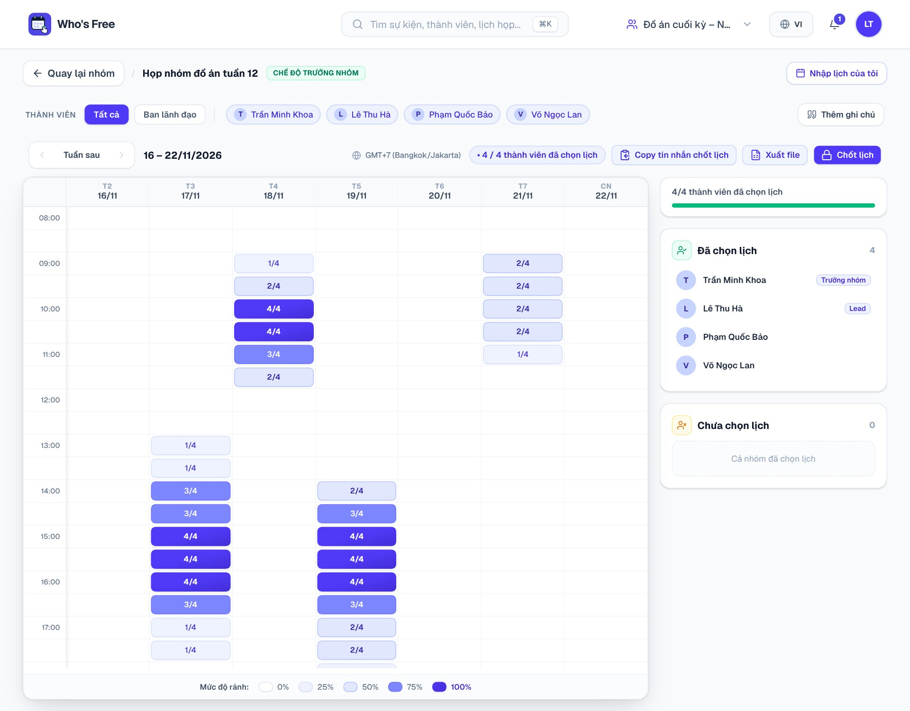
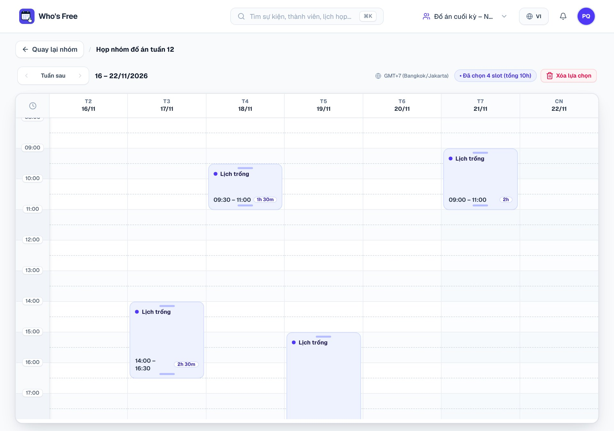
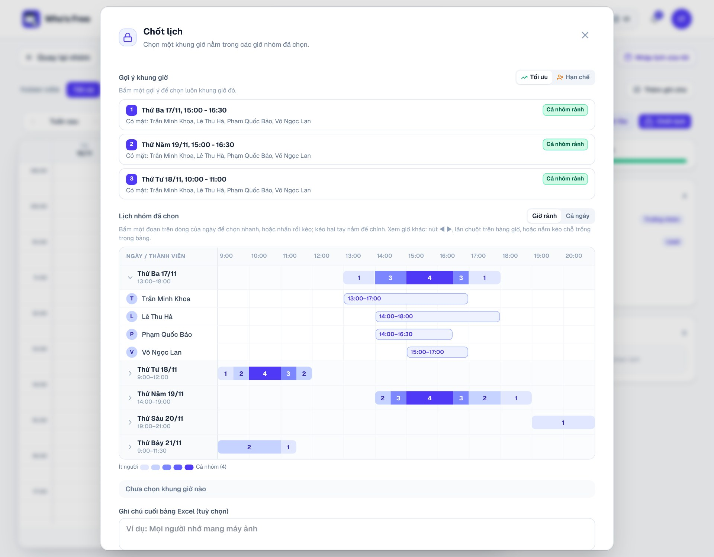
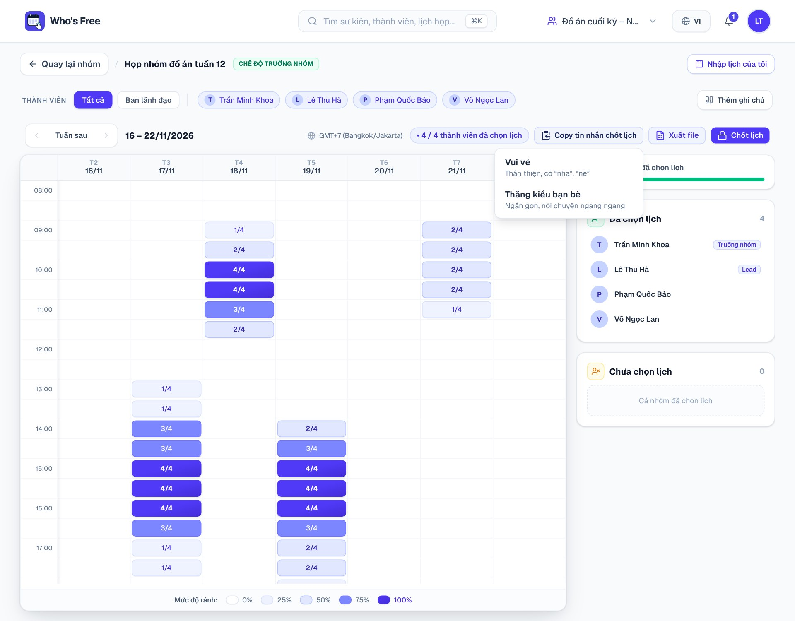
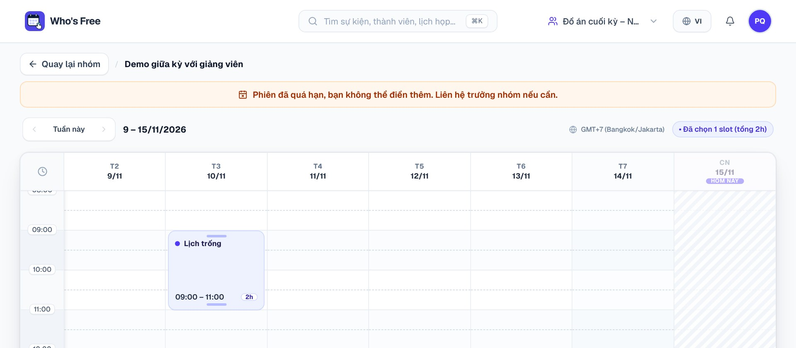
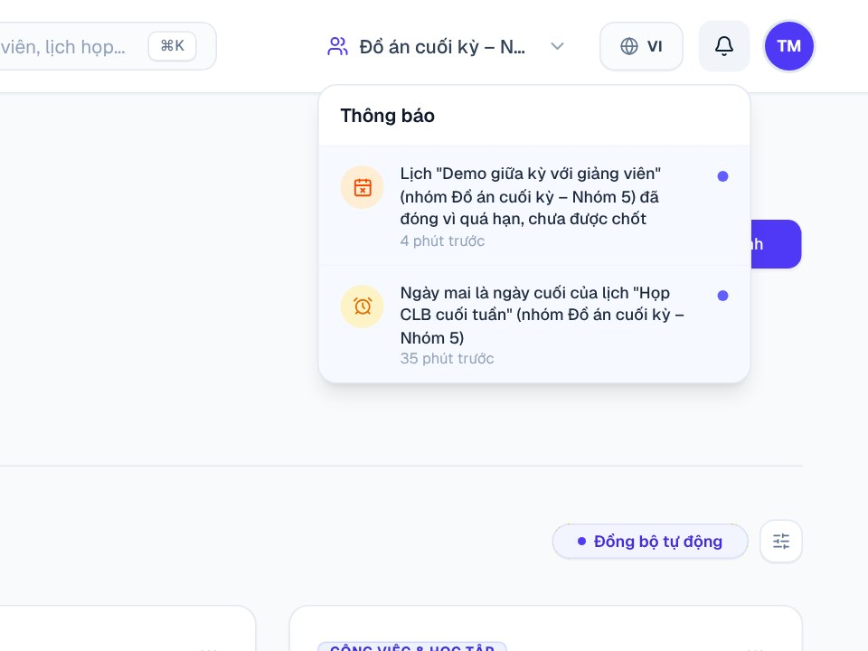
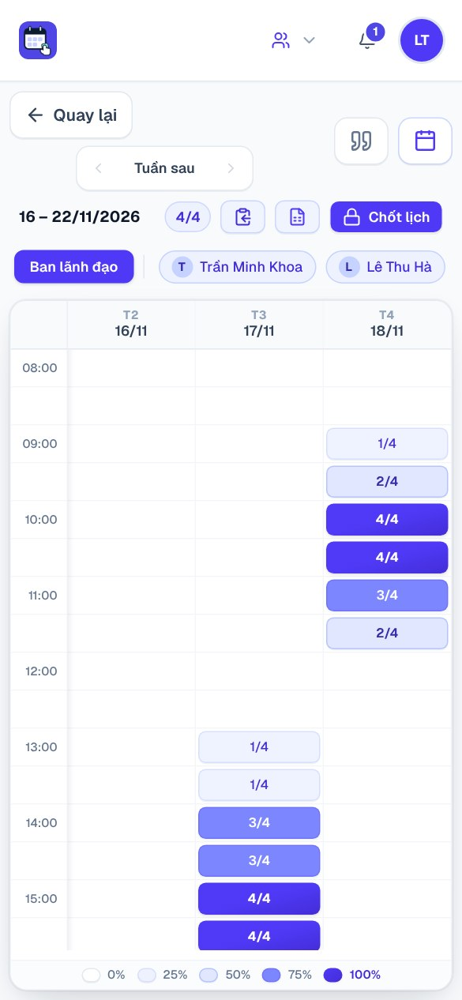
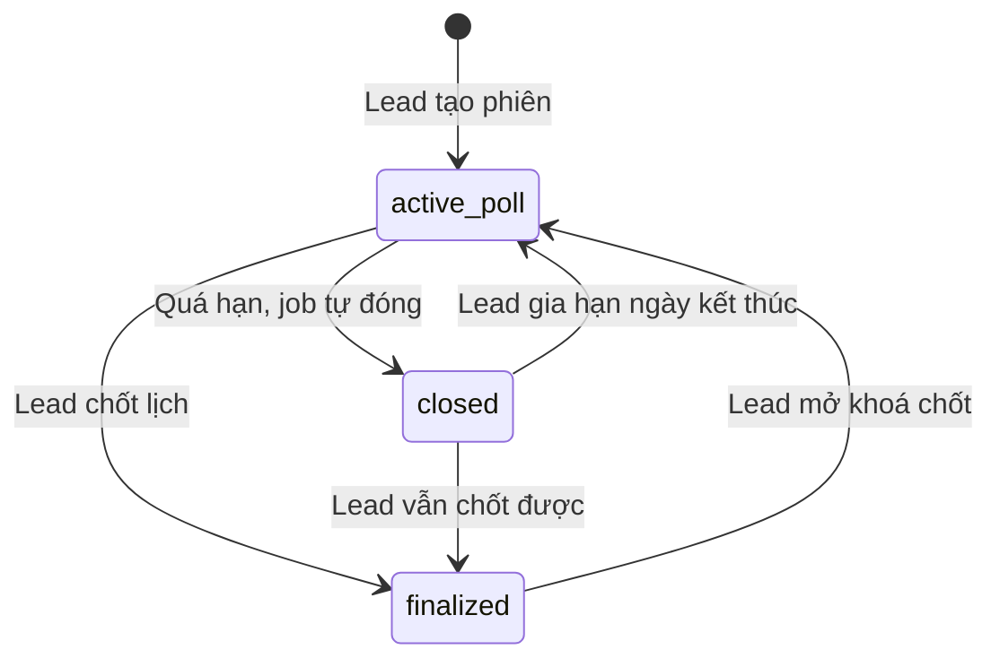
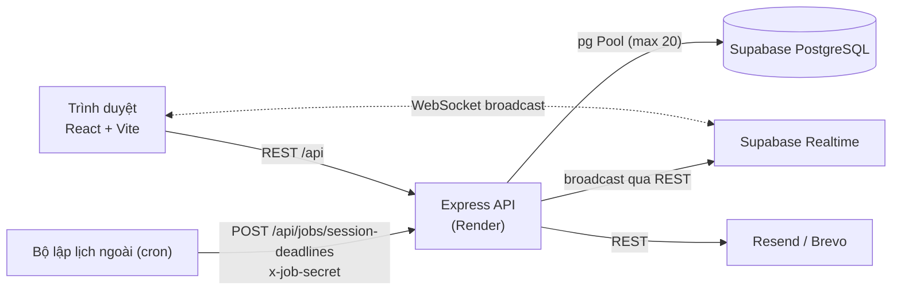

# Who's Free

> Nền tảng điều phối lịch họp nhóm: mỗi người kéo-thả giờ rảnh của mình, trưởng nhóm nhìn thấy ngay khung giờ nào nhiều người trùng nhất và chốt lịch chỉ với vài cú bấm.


**Demo trực tuyến:** [whos-free-one.vercel.app](https://whos-free-one.vercel.app/)
<sub>Backend chạy trên gói hosting miễn phí nên lần mở đầu tiên có thể chờ vài chục giây để máy chủ thức dậy; giao diện sẽ tự báo và tự thử lại.</sub>

<p align="center">
  
</p>

---

## Bài toán

Chốt một giờ họp cho 5–10 người thường biến thành một chuỗi tin nhắn dài: ai rảnh thứ mấy, ai bận giờ nào, rồi lại hỏi lại từ đầu.

**Who's Free** chuyển việc đó thành hai bước:

1. **Thành viên** kéo-thả trên lưới tuần (mỗi ô 30 phút) để đánh dấu những lúc mình rảnh.
2. **Trưởng nhóm** mở **Lead Overlap Matrix**, thấy ngay mật độ trùng lịch từng khung giờ, nhận gợi ý khung giờ tối ưu rồi chốt. Cả nhóm nhận email xác nhận.

Có một điều mình rút ra khi quan sát cách mọi người thực sự dùng: nhiều nhóm xem lịch trong app nhưng lại **nhắn nhau chốt giờ trên Zalo/Messenger**, nên phiên khảo sát cứ treo mãi không bao giờ được chốt. Vì vậy dự án có thêm ba thứ nhằm đúng vấn đề này: tự đóng phiên quá hạn, nhắc trưởng nhóm đúng lúc, và nút copy sẵn tin nhắn chốt lịch (xem phần [Tính năng](#tính-năng)).

---

## Giao diện

<table>
  <tr>
    <td width="50%"><br><sub><b>Thành viên</b> kéo-thả giờ rảnh trên lưới tuần 30 phút.</sub></td>
    <td width="50%"><br><sub><b>Chốt lịch:</b> gợi ý khung giờ tối ưu, xem được từng người rảnh lúc nào.</sub></td>
  </tr>
  <tr>
    <td width="50%"><br><sub><b>Copy tin nhắn chốt lịch</b> với hai giọng văn để dán vào nhóm chat.</sub></td>
    <td width="50%"><br><sub><b>Phiên quá hạn</b> tự đóng: thành viên chỉ xem, trưởng nhóm vẫn chốt được.</sub></td>
  </tr>
  <tr>
    <td width="50%"><br><sub><b>Thông báo</b> nhắc hạn và phiên đã đóng cho Owner/Lead.</sub></td>
    <td width="50%" align="center"><br><sub><b>Responsive</b> trên điện thoại.</sub></td>
  </tr>
</table>

---

## Điểm nhấn kỹ thuật

Phần dưới đây là những chỗ mình thấy đáng bàn nhất, kèm file để bạn mở ra kiểm chứng.

**1. Chốt lịch an toàn khi nhiều người thao tác cùng lúc.**
Trưởng nhóm đang cân nhắc chốt thì thành viên vẫn có thể lưu lịch, dễ dẫn tới chốt trên dữ liệu đã cũ. Việc chốt chạy trong một transaction, khoá dòng phiên bằng `SELECT ... FOR UPDATE` rồi mới đọc lịch và kiểm tra. Mỗi lần lưu lịch của thành viên lấy khoá `FOR SHARE` nên phải chờ. Thêm một "khoá mềm" 10 phút khi trưởng nhóm mở bảng chốt lịch để thành viên khác nhận thông báo rõ ràng thay vì bị ghi đè âm thầm. Việc thêm thành viên vào nhóm cũng có kiểm tra sức chứa dưới tranh chấp, có test hai request cạnh tranh một chỗ cuối cùng.
→ `BE/src/models/session.model.js` (`finalizeLocked`), `BE/src/models/availability.model.js`

**2. Job hẹn giờ idempotent và đúng múi giờ.**
Phiên quá hạn tự chuyển sang `closed`; 20:00 giờ Việt Nam của ngày trước hạn, Owner/Lead nhận email nhắc. Chạy lặp hay chạy song song hai tiến trình đều không được gửi email trùng, nên mỗi lần gửi đều "giành quyền" bằng `UPDATE ... WHERE cột IS NULL RETURNING` (nguyên tử), gửi thất bại thì trả cột về `NULL` để lần sau thử lại. Mốc giờ được tính ngay trong SQL theo `Asia/Ho_Chi_Minh`, có test trên Postgres thật cho các mốc 19:59/20:00 và 23:59/00:00. Endpoint chỉ nhận request có `x-job-secret`, so sánh bằng `timingSafeEqual` sau khi băm để không lộ độ dài; thiếu biến môi trường thì endpoint đóng hẳn (503). Mỗi lần chạy được ghi lại ở bảng `job_runs`.
→ `BE/src/models/session-deadline.model.js`, `BE/src/middlewares/job-secret.middleware.js`

**3. Realtime có đường lùi.**
Mỗi lần thành viên lưu lịch, BE phát đúng một sự kiện broadcast qua Supabase Realtime (gửi bằng REST và gỡ channel ngay để không rò bộ nhớ); FE debounce 1 giây. Nếu WebSocket rớt hoặc bỏ sót, polling 25 giây chỉ chạy khi tab đang hiển thị làm lưới an toàn.
→ `FE/src/hooks/useSessionsRealtime.js`, `BE/src/services/realtime.service.js`

**4. Chịu được hosting miễn phí "ngủ đông".**
Backend trên gói miễn phí ngủ khi không có ai dùng, request đầu tiên có thể mất hàng chục giây. FE phát hiện chậm, báo người dùng đang đánh thức máy chủ và tự thử lại (tối đa 90 giây) thay vì hiện lỗi.
→ `FE/src/utils/serverWake.js`

**5. Một bài học về lỗi "im lặng".**
Khi xem log production, mình thấy lỗi `relation "group_invitations" does not exist` lặp đều 30 giây một lần (đúng nhịp polling chuông thông báo). Nguyên nhân kép: migration chưa từng chạy trên production, và model lời mời có cơ chế "dự phòng" âm thầm lưu vào RAM khi DB lỗi, nên lời mời vẫn có vẻ gửi thành công. Mình tạo bảng, rồi bỏ hẳn đường lùi đó để lỗi DB nổi lên đúng chỗ. API thông báo cũng được sửa để một nguồn lỗi không kéo sập cả danh sách, và chuông ở FE không còn nuốt lỗi.
→ `BE/src/models/group-invitation-mutation.model.js`, `BE/src/services/notification.service.js`

**6. Xác thực và bảo vệ API.**
Access token ngắn hạn kèm refresh token xoay vòng (lưu phía server ở bảng `refresh_sessions`), đăng nhập Google OAuth, đặt lại mật khẩu bằng OTP qua email. Rate limit theo cả IP lẫn tài khoản, validate đầu vào bằng Zod, `helmet`, câu lệnh SQL tham số hoá, RLS bật trên các bảng.
→ `BE/src/middlewares/rateLimit.middleware.js`, `BE/src/models/refresh-session.model.js`

---

## Tính năng

**Nhóm và phân quyền.** Ba vai trò độc lập theo từng nhóm: **Owner**, **Lead**, **Member** (một người có thể là Lead ở nhóm này nhưng là Member ở nhóm khác). Mời thành viên qua email (token băm, hết hạn sau 24 giờ, gửi lại hoặc thu hồi được) hoặc qua invite link. Chỉ Owner mới cấp được vai trò Lead.

**Khảo sát giờ rảnh.** Mỗi nhóm có nhiều phiên khảo sát, mỗi phiên có khoảng ngày riêng. Thành viên kéo-thả các ô 30 phút, lưu tự động có debounce và tự thử lại khi mất mạng.

**Lead Overlap Matrix.** Heatmap mật độ trùng lịch theo từng ô, lọc theo thành viên hoặc nhóm "Ban lãnh đạo", gợi ý khung giờ ở hai chế độ *Tối ưu* và *Hạn chế*, hiển thị ai chưa chọn lịch.

**Chốt lịch.** Chọn khung giờ nằm trong những giờ nhóm đã chọn, ghi chú, khoá chỉnh sửa, gửi email xác nhận cho cả nhóm trong một request batch, xuất file Excel, và mở khoá nếu cần chốt lại.

**Chống phiên bị bỏ quên.**
- Phiên quá hạn mà chưa chốt tự chuyển sang **Đã đóng** (thành viên không điền thêm được, trưởng nhóm vẫn chốt hoặc gia hạn bằng cách sửa ngày kết thúc) và email báo Owner/Lead.
- 20:00 ngày liền trước hạn có email và thông báo nhắc.
- **Copy tin nhắn chốt lịch** với hai giọng văn (vui vẻ, hoặc ngắn gọn kiểu bạn bè), có sẵn khung giờ nhiều người rảnh nhất và link, để trưởng nhóm dán thẳng vào Zalo/Messenger.

**Khác.** Song ngữ Việt/Anh, giao diện responsive, cập nhật gần thời gian thực.

**Ngoài phạm vi MVP:** AI/LLM, mobile native, thanh toán, quản lý cấp tổ chức.

### Vòng đời của một phiên



---

## Kiến trúc



Backend theo kiến trúc phân tầng, mỗi tầng một trách nhiệm:

```
Request → Controller → Service → Model → PostgreSQL
```

- **Controller:** nhận request, gọi service, trả response. Không chứa nghiệp vụ, không chạm DB.
- **Service:** toàn bộ logic nghiệp vụ. Không gọi thẳng DB client.
- **Model:** chỉ thao tác DB.

Dự án đặt ngưỡng kích thước file (ví dụ controller 100 dòng, service 200 dòng, component 200 dòng) và tách file khi vượt, quy tắc nằm trong [`CLAUDE.md`](CLAUDE.md).

---

## Công nghệ

| Tầng | Công nghệ |
| :--- | :--- |
| Frontend | React 19, Vite 8, React Router 8, Tailwind CSS 4, shadcn/ui, react-hook-form + Zod, i18next |
| Backend | Node.js, Express 4 (ES Modules), `pg`, Zod, `jsonwebtoken`, `helmet`, `express-rate-limit`, `exceljs` |
| Dữ liệu và xác thực | Supabase PostgreSQL (RLS), Supabase Auth, Supabase Realtime |
| Email | Resend hoặc Brevo |
| Hạ tầng | Vercel (FE), Render (BE), Supabase |
| Kiểm thử | `node:test` có sẵn của Node.js, không thêm framework test |

---

## Chất lượng và kiểm thử

**421 test tự động**, đều đang pass:

| Nhóm | Số test | Ghi chú |
| :--- | ---: | :--- |
| BE unit (`BE/tests/unit`) | 174 | Logic thuần, giả lập DB |
| BE integration (`BE/tests`) | 171 | Chạy trên PostgreSQL thật; thêm 2 test đánh dấu `todo` |
| FE (`FE/tests`) | 76 | Logic thuần: dựng tin nhắn, xử lý lỗi lưu lịch, ánh xạ thông báo, i18n |

Test tích hợp bao phủ các tình huống khó: tranh chấp chỗ cuối cùng trong nhóm, luồng mời và chấp nhận lời mời, chốt lịch và khoá chỉnh sửa, và các mốc giờ của job hẹn giờ. Mỗi hàm service mới đều có unit test (happy path, input sai, không tìm thấy). Code FE được kiểm tra bằng ESLint.

---

## Chạy local

**Yêu cầu:** Node.js >= 18 (khuyên dùng 20+), một project Supabase.

### 1. Cơ sở dữ liệu

Tạo schema bằng `DB/schema.sql` (hoặc `npm run db:setup` trong `BE/` để chạy và tự kiểm tra). Các thay đổi sau này nằm trong `DB/migrations/`.

### 2. Backend

```bash
cd BE
npm install
cp .env.example .env   # điền các biến bên dưới
npm run dev            # http://localhost:5000
```

| Biến | Ý nghĩa |
| :--- | :--- |
| `DATABASE_URL` | Chuỗi kết nối PostgreSQL. Production nên dùng Supabase Pooler (Transaction mode, cổng 6543) |
| `SUPABASE_URL`, `SUPABASE_ANON_KEY`, `SUPABASE_SERVICE_ROLE_KEY` | Kết nối Supabase |
| `JWT_SECRET`, `JWT_REFRESH_SECRET` | Chuỗi ngẫu nhiên dài |
| `CLIENT_ORIGIN`, `API_BASE_URL` | Địa chỉ FE và BE (dùng cho CORS và link trong email) |
| `EMAIL_PROVIDER` | Chọn nhà gửi email: `resend` (mặc định) hoặc `brevo` |
| `RESEND_API_KEY`, `RESEND_FROM_EMAIL` | Cấu hình khi dùng Resend |
| `BREVO_API_KEY`, `BREVO_SENDER_EMAIL`, `BREVO_SENDER_NAME` | Cấu hình khi dùng Brevo (`BREVO_SENDER_NAME` không bắt buộc) |
| `JOB_SECRET` | Bí mật cho endpoint job hẹn giờ. Để trống thì endpoint tự đóng |

### 3. Frontend

```bash
cd FE
npm install
cp .env.example .env.local   # điền VITE_SUPABASE_URL và VITE_SUPABASE_ANON_KEY
npm run dev                  # http://localhost:5173
```

`VITE_BACKEND_API_BASE_URL` để trống: môi trường dev đi qua Vite proxy tới `localhost:5000`, production đi qua rewrite trong `vercel.json` (giúp Safari/iOS không chặn cookie refresh).

### 4. Chạy test

```bash
# BE unit (không cần DB)
cd BE && node --test tests/unit/*.test.js

# BE integration (cần PostgreSQL đã áp schema)
cd BE && DATABASE_URL=postgres://... NODE_ENV=test \
  JWT_SECRET=test-secret-at-least-32-characters-long \
  CLIENT_ORIGIN=http://localhost:5173 \
  node --test tests/*.test.js

# FE
cd FE && npm run lint && npm test
```

### Job hẹn giờ

Endpoint `POST /api/jobs/session-deadlines` (header `x-job-secret`) được thiết kế để một bộ lập lịch bên ngoài gọi định kỳ, nên gọi ít nhất mỗi giờ để không bỏ lỡ khung nhắc 20:00–23:59 giờ Việt Nam.

---

## Cấu trúc thư mục

```
Who's Free/
├── BE/
│   ├── src/
│   │   ├── controllers/   # parse request → service → response
│   │   ├── services/      # nghiệp vụ
│   │   ├── models/        # truy vấn DB
│   │   ├── middlewares/   # auth, rate limit, validate, job secret
│   │   ├── routes/  validations/  utils/  constants/  configs/
│   └── tests/
│       ├── unit/          # logic thuần, giả lập DB
│       └── *.test.js      # integration, DB thật
├── FE/
│   ├── src/
│   │   ├── pages/         # Auth, Group, Home, LeadMatrix, MemberMatrix, Invite, Join
│   │   ├── components/  hooks/  contexts/  service/  utils/  locales/
│   └── tests/
├── DB/                    # schema.sql và migrations/
└── docs/
    ├── screenshots/
    └── superpowers/       # specs (thiết kế) và plans (kế hoạch triển khai)
```

---

## Quy trình phát triển

- **Viết hợp đồng trước khi code.** Với tính năng chạm cả BE lẫn FE, mình viết trước một *contract* (endpoint, schema request/response, hành vi, rủi ro) rồi mới chia việc. Ví dụ: [`docs/superpowers/specs/2026-11-15-session-deadline-reminder-contract.md`](docs/superpowers/specs/2026-11-15-session-deadline-reminder-contract.md).
- **Nhánh và pull request.** Nhánh tính năng tách từ `dev`, gộp qua pull request (hơn 80 PR đã được merge), `main` là nhánh production.
- **Danh sách kiểm tra trước khi xong:** kích thước file, N+1, `SELECT *`, auth guard cho route mới, unit test cho service mới, không còn `console.log`, không import thừa.
- **Có dùng trợ lý AI.** Mình dùng Claude Code như một công cụ hỗ trợ viết code, review và dựng test; các quyết định thiết kế, phạm vi sản phẩm và việc kiểm chứng kết quả do mình đảm nhiệm. Mọi thay đổi đều đi qua review và chạy test trước khi gộp.

---

## Hạn chế đã biết và hướng phát triển

- Chưa có CI tự động (hiện chạy test thủ công trước khi gộp).
- Chưa có kiểm thử tải chính thức; kết nối DB dùng pool tối đa 20.
- Realtime mới dừng ở việc cập nhật số người đã phản hồi; chưa hiển thị lịch của nhau theo thời gian thực (cố ý, vì lý do riêng tư).
- Chưa có thông báo đẩy (push) hay đồng bộ sang Google Calendar.

---

## Tác giả

**HoangAnh-ToiChoi**, thiết kế và phát triển toàn bộ dự án (giao diện, API, cơ sở dữ liệu, triển khai).
GitHub: [@HoangAnh-ToiChoi](https://github.com/HoangAnh-ToiChoi)
Email: [hoanganh281205@gmail.com](mailto:hoanganh281205@gmail.com)
Demo: [whos-free-one.vercel.app](https://whos-free-one.vercel.app/)
